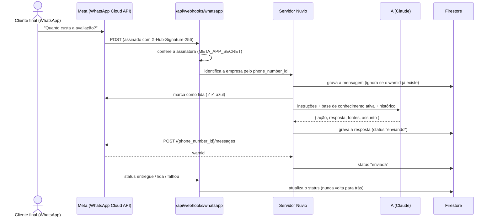

# 2. WhatsApp (API oficial da Meta) e IA

## 2.1 Como uma mensagem é atendida

**Regras que valem sempre (no nosso código, não na IA):**

| Regra | Onde |
| --- | --- |
| Palavras que pedem atendente → transfere (ou avisa o horário fora do expediente) | `ai/responder.ts` + `bot/engine.ts` |
| Depois de N respostas sem informação → transfere | idem |
| Limite de conversas do plano atingido → IA pausa e a equipe é avisada | `PlatformStore.receiveMessage` |
| Janela de 24 h: depois disso, só modelo (template) aprovado | `PlatformStore.sendAgentMessage` e erro 131047 da Meta |
| Conversa com a equipe (assumida) → a IA não responde | `needsReply` |
| Mensagem repetida (mesmo wamid) → ignorada | `PlatformStore.inbound` |
| Conversas de demonstração → nunca são enviadas | `deliverPending` (status "simulated") |

## 2.2 A IA

- **Modelo:** Claude (Anthropic), `ANTHROPIC_MODEL` (padrão `claude-sonnet-5-5`).
- **Entrada:** instruções do assistente (nome, tom, objetivo), **somente a base de conhecimento ativa** da empresa (até ~24 mil caracteres) e as últimas 20 mensagens.
- **Saída estruturada** (ferramenta `responder`): ação (`answer`, `fallback`, `handoff`), texto, ids das fontes e assunto. O servidor confere tudo: ação válida, texto não vazio e fontes que existem.
- **Proteções no prompt:**
  - responder só com a base;
  - não pedir senha nem cartão;
  - ignorar pedidos do cliente para mudar as regras (injeção de prompt).
- **Sem chave ou se a IA falhar:** volta para o motor local (busca na base com sinônimos). O atendimento não para.

## 2.3 Formas de conectar o número

| Forma | Para quê | Como |
| --- | --- | --- |
| **Simulada** | Demonstração, sem chaves da Meta | Painel → Integrações → Conectar (demonstração): número + código de 6 dígitos |
| **Manual** | Número de **teste** da Meta, ou empresa que já tem token de usuário do sistema | Painel → Integrações → Conexão manual: Phone number ID + token (validados na Meta e guardados **cifrados**) |
| **Cadastro incorporado** | Produção: cada cliente conecta o próprio número em poucos cliques | Botão "Conectar com o Facebook" (SDK da Meta) → código → token, inscrição do app na WABA e registro do número |

## 2.4 Como ativar com a Meta (passo a passo)

**Teste gratuito (sem contrato e sem verificação da empresa):**

1. Em **developers.facebook.com**: Meus apps → **Criar app** → tipo **Empresa** → adicionar o produto **WhatsApp**.
2. Em **WhatsApp → Configuração da API**, a Meta dá um **número de teste** e um **token temporário** (24 h). Cadastre até **5 celulares** que poderão receber mensagens.
3. Em **Configurações do app → Básico**, copie a **Chave secreta do app**.
4. No servidor da Nuvio (variáveis do Netlify), configure:
   - `META_APP_SECRET`: a chave secreta;
   - `WHATSAPP_VERIFY_TOKEN`: um texto qualquer, combinado no passo 5.
5. Em **WhatsApp → Configuração → Webhook**:
   - URL: `https://<site>/api/webhooks/whatsapp`;
   - token de verificação: o mesmo texto do `WHATSAPP_VERIFY_TOKEN`;
   - inscreva o campo **messages**.
6. No painel da Nuvio, como cliente: **Integrações → Conexão manual** → Phone number ID + token.
7. Mande "Quanto custa?" de um dos celulares cadastrados para o número de teste. A resposta da IA deve chegar, e o painel mostra a conversa com ✓ e ✓✓.

**Produção (clientes reais):**

1. Verificação da empresa na Meta (Business Manager).
2. Revisão do app para a permissão `whatsapp_business_management` / `whatsapp_business_messaging`.
3. Configurar o **Cadastro incorporado** (Facebook Login for Business → configuração do tipo WhatsApp) e definir:
   - `META_APP_ID`;
   - `META_CONFIG_ID`.
4. Modelos (templates) aprovados para mensagens fora da janela de 24 h.
5. Cobrança da Meta por conversa (marketing/utilidade/autenticação/serviço) — considerar no preço dos planos.

## 2.5 Variáveis de ambiente

| Variável | Obrigatória | Para quê |
| --- | --- | --- |
| `META_APP_SECRET` | Para o WhatsApp real | Confere a assinatura dos webhooks e troca o código do cadastro incorporado |
| `WHATSAPP_VERIFY_TOKEN` | Para o WhatsApp real | Verificação do webhook |
| `META_APP_ID`, `META_CONFIG_ID` | Para o cadastro incorporado | Botão "Conectar com o Facebook" |
| `META_GRAPH_VERSION` | Não (padrão v23.0) | Versão da Graph API |
| `META_GRAPH_BASE` | **Só em testes** | Aponta para o simulador da Meta (`tests/e2e/whatsapp.mjs`) |
| `ANTHROPIC_API_KEY`, `ANTHROPIC_MODEL` | Para a IA | Respostas com Claude |
| `FIREBASE_*`, `SESSION_SECRET`, `VAULT_KEY` | Sim (produção) | Banco, sessão e cifra dos tokens do WhatsApp |
