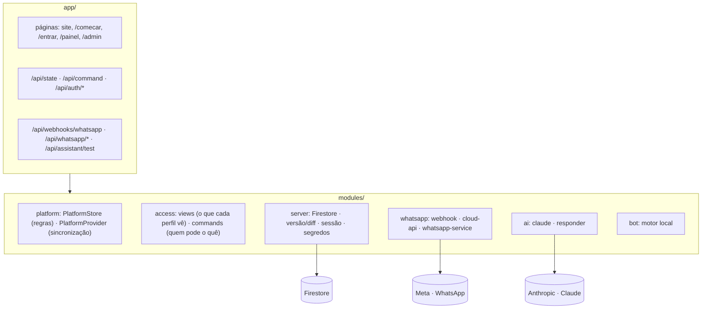

# 3. Arquitetura e segurança

## 3.1 Camadas

**Mesmo desenho do KreativeArt:** a tela executa a regra na hora, e o servidor repete a mesma ação, com o perfil da sessão e os mesmos ids, gravando só o que mudou numa transação com controle de versão. O que muda na Nuvio: as **respostas da IA e os envios ao WhatsApp acontecem no servidor, depois** da ação (`afterChange`), porque dependem de serviços externos.

## 3.2 Segurança

| # | Ameaça | Proteção | Teste |
| --- | --- | --- | --- |
| S1 | Senhas roubadas | scrypt com sal; hash nunca sai do servidor | API-02/03 |
| S2 | Empresa ver/alterar dados de outra | Visão por perfil (`views.ts`) e dono conferido em cada ação (`commands.ts`) | API-03/05, UT-08 |
| S3 | Backoffice ler conversas dos clientes finais | O backoffice recebe só números agregados | API-04 |
| S4 | Webhook falso (alguém fingindo ser a Meta) | Assinatura **X-Hub-Signature-256** com `META_APP_SECRET`, sobre o corpo bruto | WA-03, UT-05 |
| S5 | Mensagem repetida/reenviada | Deduplicação pelo `wamid` | WA-05 |
| S6 | Vazamento do token do WhatsApp | Token validado na Meta, guardado **cifrado** (AES-256-GCM, `VAULT_KEY`) numa coleção só do servidor; nunca vai ao navegador | WA-02, UT-08 |
| S7 | Injeção de prompt ("ignore as regras…") | Instrução explícita no prompt + regras críticas aplicadas pelo código + saída estruturada conferida | UT-07 |
| S8 | IA inventar informação | Prompt "somente com a base"; fontes conferidas; ação `fallback` / transferência após N falhas | UT-07 |
| S9 | CSRF | Alterações só com `Origin` do próprio site + JSON + cookie SameSite | API-06 |
| S10 | Simular mensagens em conversas reais | Simulação só em conversas marcadas como demonstração | commands |
| S11 | Envio para clientes fora da janela de 24 h | Bloqueado no painel; erro 131047 da Meta tratado | WA-08, UT-06 |

## 3.3 Limites conhecidos e evolução

| Item | Hoje | Evolução |
| --- | --- | --- |
| Escala das conversas | Todos os dados ficam num estado versionado (bom para portfólio e dezenas de empresas) | Conversas em coleção por empresa, com consultas e paginação |
| Fila de envio | Envio na mesma requisição (webhook/ação) | Fila com novas tentativas (ex.: tarefas agendadas) |
| Modelos (templates) | Envio pronto em `cloud-api.sendTemplate`, sem tela | Tela de modelos e sincronização com a Meta |
| Mídia (áudio, imagem) | Vira aviso para a equipe | Baixar a mídia e transcrever áudio |
| Pagamento das assinaturas | Simulado | Gateway (Mercado Pago/Stripe), como no KreativeArt |
