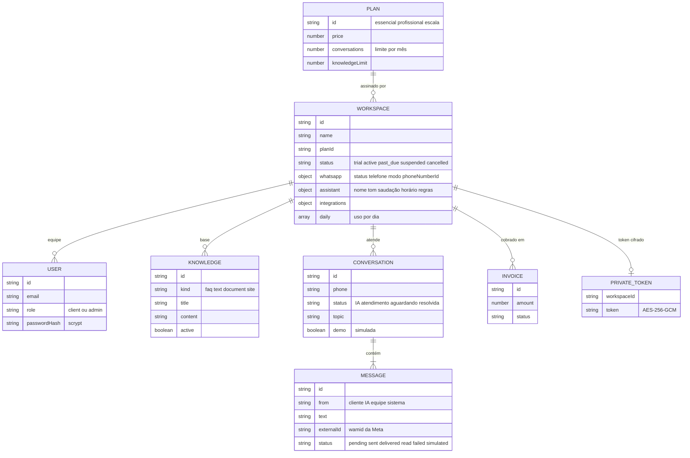
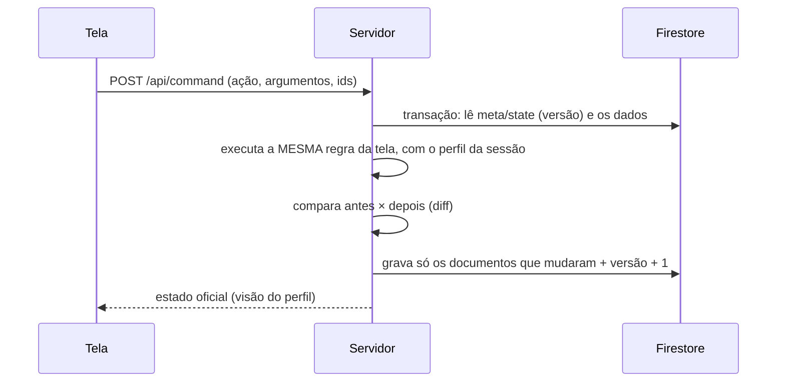

# 4. Modelo de dados

## Entidades



## Coleções do Firestore

| Coleção | Conteúdo | Quem lê |
| --- | --- | --- |
| `plans` | Planos e preços | Todos |
| `workspaces` | Empresas: plano, situação, WhatsApp, assistente, uso diário | A própria empresa; o backoffice (sem conversas) |
| `users` | Pessoas com acesso (hash scrypt da senha) | Só o servidor (o hash nunca é enviado) |
| `knowledge` | Base de conhecimento de cada empresa | A própria empresa |
| `conversations` | Conversas com as mensagens | A própria empresa |
| `invoices` | Faturas das assinaturas | A empresa e o backoffice |
| `meta` | Documento `state`: configurações, histórico de receita e **versão** dos dados | Só o servidor |
| `private` | Tokens do WhatsApp de cada empresa, **cifrados** (AES-256-GCM com `VAULT_KEY`) | Só o servidor |

## Como uma alteração é gravada



- **Transação:** se duas pessoas alteram ao mesmo tempo, o Firestore refaz a transação com os dados novos.
- **Diff:** só os documentos alterados são gravados. Isso economiza a cota gratuita (plano Spark: 20 mil gravações por dia).
- **No computador:** com `DATA_STORE=file`, os mesmos dados ficam em `.data/nuvio.json`, com as mesmas regras. É assim que os testes rodam sem gastar a cota.

## Criar ou restaurar os dados

```bash
npm run db:setup
```

O comando cria `SESSION_SECRET` e `VAULT_KEY` no `.env.local`, se ainda não existirem, e grava a demonstração no Firestore: empresas de exemplo, a Clínica Lumina com conversas e o backoffice.

> Rode o comando só quando precisar restaurar os dados: cada execução consome gravações da cota gratuita.
