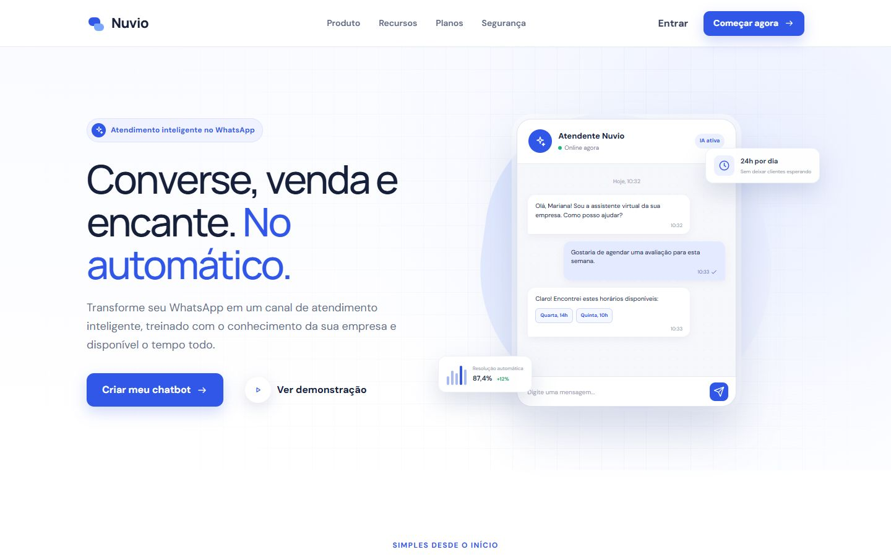
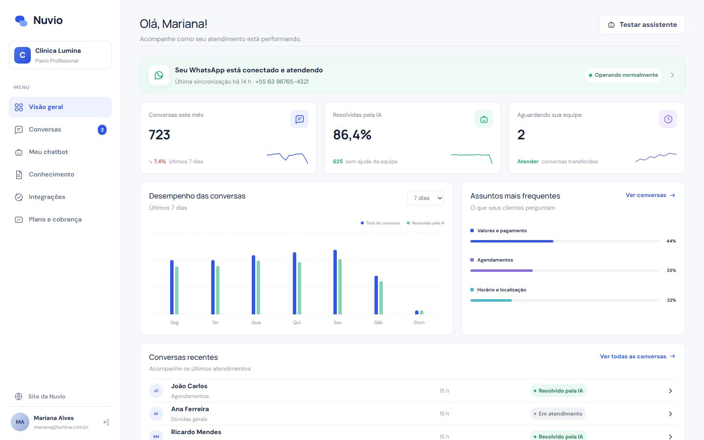
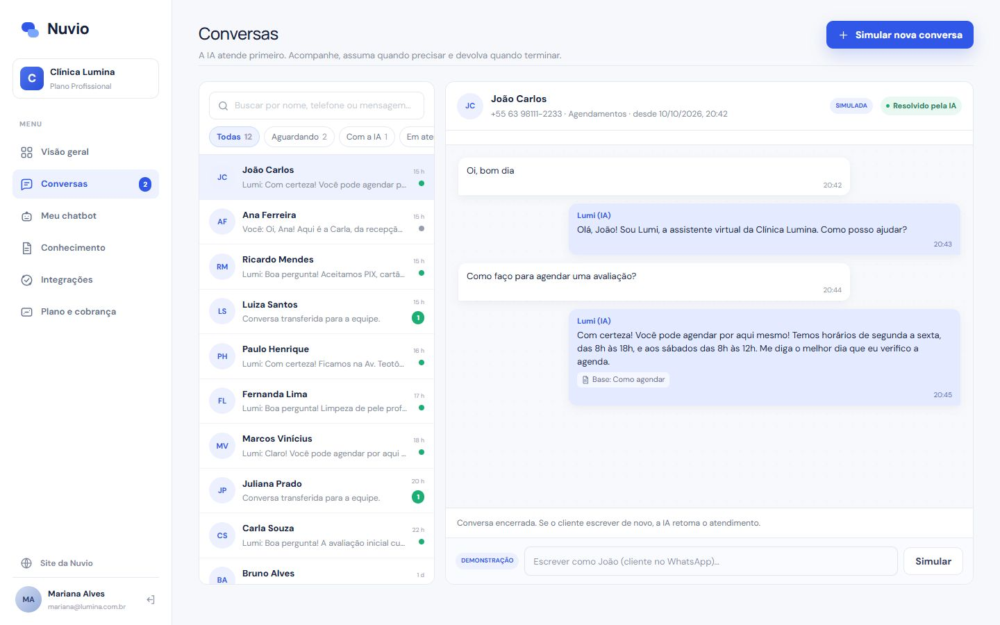

# Nuvio — atendimento inteligente no WhatsApp

SaaS em que empresas criam um **assistente virtual para o WhatsApp**, treinado com o conhecimento da própria empresa. A IA atende 24h. A equipe acompanha as conversas, assume quando precisa e devolve para a IA. A Nuvio cobra uma assinatura mensal por plano.

Design de origem: Figma Make (`Figma Make Projects/Chatbot Platform for WhatsApp`).

**Status (10/10/2026):** interface completa + **servidor e banco de dados (Firestore)** + **WhatsApp Cloud API** (receber, responder, enviar, status de entrega, regra das 24 h, cadastro incorporado e conexão manual) + **IA (Claude)** com reserva no motor local. O WhatsApp foi testado com um **simulador da Meta**; o teste com a Meta real está pendente (roteiro em [`Testes/03-whatsapp.md`](Testes/03-whatsapp.md)). Documentação e testes concluídos; **pronto para publicar** (`npm run env:push` + `npm run deploy`, ver [Documents/05](Documents/05-publicacao-e-operacao.md)), aguardando espaço no Netlify. Próxima etapa: pagamento das assinaturas.

- **Stack:** Next.js 16 · React 19 · TypeScript · MobX · Firebase Firestore · WhatsApp Cloud API · Claude (Anthropic) · Vitest · Puppeteer
- **Documentação:** [`Documents/`](Documents/README.md) (abra `Documents/visualizar.html`) · **Testes:** [`Testes/`](Testes/README.md)
- **Ativar o WhatsApp real e a IA:** [`Documents/02-whatsapp-e-ia.md`](Documents/02-whatsapp-e-ia.md)

## Telas

**Site da Nuvio**



**Painel da empresa (demonstração)**



**Conversas atendidas pela IA**



## Rodando

```bash
npm install
npm run db:setup   # cria as chaves locais e grava a demonstração no Firestore (uma vez)
npm run dev        # http://localhost:3000 (sem firebase-service-account.json: banco local em .data/)
npm test           # 28 testes unitários
```

**Acesso de demonstração** (senha `demo123`, com botões de acesso rápido na tela Entrar):

| Perfil | E-mail |
| --- | --- |
| Cliente — Clínica Lumina (plano Profissional, WhatsApp conectado) | `mariana@lumina.com.br` |
| Backoffice Nuvio | `admin@nuvio.com.br` |

Outras 11 empresas existem para o backoffice. O botão **Ver demonstração** do site entra direto na Clínica Lumina, e **Restaurar demonstração** (backoffice) volta tudo ao início.

## O que já funciona

| Área | Funcionalidades |
| --- | --- |
| Site | Página do design com os botões ligados; planos vindos da configuração do backoffice; páginas de Privacidade e Termos |
| Cadastro (4 etapas) | Empresa e senha, plano, assistente (nome, tom, objetivo, site), conexão e termos → **14 dias grátis** |
| Visão geral | Números reais do mês, desempenho dos últimos 7/14 dias, assuntos mais frequentes, conversas recentes, aviso se o WhatsApp não estiver conectado |
| Conversas | Caixa de entrada com filtros e busca. A IA responde citando a fonte da base; a equipe **assume**, responde, **devolve para a IA** ou **encerra**. Botões de demonstração simulam clientes |
| Meu chatbot | Identidade, tom, objetivo, boas-vindas (`{nome}`), resposta quando não sabe, palavras que pedem atendente, transferência após N falhas, horário da equipe, mensagem fora do horário, liga/desliga — com **teste ao vivo** ao lado |
| Conhecimento | Perguntas e respostas, textos, documentos (.txt/.md/.csv) e sites; ativar/desativar, editar, remover; limite por plano |
| Integrações | WhatsApp Business em 2 etapas (número → código); Google Agenda, Planilhas Google, RD Station, Webhook; Instagram "em breve" |
| Plano e cobrança | Uso do mês, comparar e mudar de plano, cartão (só bandeira + 4 últimos), ativar assinatura no fim do teste, faturas, cancelar |
| Backoffice | MRR e evolução em 12 meses, clientes (busca, filtros, detalhe, mudar plano, suspender/reativar), assinaturas e faturas, operação (volume, conexões, alertas de uso/cobrança/ativação), configurações (preços e limites dos planos, dias de teste, alerta de uso) |

## Como o robô responde (demonstração)

1. Pediu atendente (palavras configuradas) → transfere para a equipe, ou avisa o horário se estiver fora do expediente.
2. Procura a resposta na **base de conhecimento**: perguntas frequentes e trechos de textos/documentos, com acentos e sinônimos tratados ("preço" = "valor" = "quanto custa"). A resposta usa o tom escolhido e registra a fonte.
3. Saudação → mensagem de boas-vindas com o nome do cliente.
4. Não achou → resposta padrão. Depois de N tentativas sem resposta, transfere.

Na etapa de APIs, o passo 2 passa a ser feito por um modelo de IA, usando a base como contexto. As regras e o formato do resultado continuam os mesmos.

## Próximas etapas (APIs externas)

| Integração | Para quê |
| --- | --- |
| WhatsApp Cloud API (Meta) + cadastro incorporado | Receber e enviar mensagens reais e conectar o número do cliente |
| IA (Claude) | Respostas naturais a partir da base de conhecimento |
| Gateway de pagamento (Mercado Pago ou Stripe) | Cobrança recorrente da assinatura |
| Banco de dados + login no servidor | Igual ao KreativeArt: Firestore, sessão segura, dados por empresa |
| Leitura de PDF/Word e de sites | Alimentar a base automaticamente |

## Testes

```bash
npm test                                          # 28 unitários
npx next dev -p 3006                              # em outro terminal:
npm run test:flows -- http://localhost:3006       # 9 fluxos completos
npm run test:api -- http://localhost:3006         # 7 verificações de segurança
npm run test:smoke -- http://localhost:3006       # 17 páginas (MOBILE=1 para celular)
node tests/e2e/whatsapp.mjs --env                 # variáveis para o simulador da Meta; suba o site com elas e:
npm run test:whatsapp -- http://localhost:3006    # 10 verificações do WhatsApp
```
