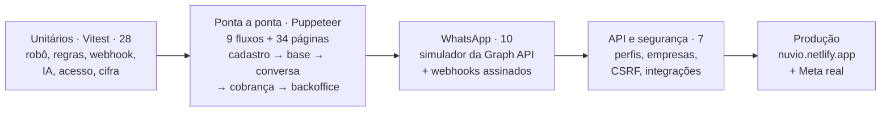

# Testes — Nuvio

**Última execução:** 10/10/2026 · **Resultado geral:** ✅ aprovado (local) · ⏳ teste com a Meta real e produção após a publicação

## Resumo

| Nível | Documento | Casos | Resultado |
| --- | --- | --- | --- |
| Unitários (automatizados) | [01-unitarios.md](01-unitarios.md) | 28 | ✅ 28/28 |
| Ponta a ponta (navegador real) | [02-ponta-a-ponta.md](02-ponta-a-ponta.md) | 9 fluxos + 34 páginas | ✅ 9/9 · 34/34 |
| WhatsApp (simulador da Meta + roteiro real) | [03-whatsapp.md](03-whatsapp.md) | 10 + 8 | ✅ 10/10 · ⏳ Meta real |
| API e segurança | [04-api-e-seguranca.md](04-api-e-seguranca.md) | 7 | ✅ 7/7 |
| Produção (Netlify + Firestore) | [05-producao.md](05-producao.md) | roteiro pronto | ⏳ após publicar |
| Incidentes | [06-incidentes.md](06-incidentes.md) | 8 | ✅ resolvidos |

As saídas brutas de cada execução estão em [`resultados/`](resultados/).

## Estratégia



**Banco nos testes:**

- **Primeira rodada:** os fluxos, a API e as páginas foram aprovados no **Firestore real** (projeto `nuvio-97b72`).
- **Rodada registrada em `resultados/`:** feita com o banco local (`DATA_STORE=file`), que tem as mesmas regras. Assim os testes não gastam a cota gratuita nem deixam empresas de teste nos dados do portfólio.

## Como rodar de novo

Na pasta do projeto:

```bash
npm test
```

Com o site rodando com banco local (configuração `nuvio-testes` do `.claude/launch.json`, porta 3016), em outro terminal:

```bash
npm run test:flows -- http://localhost:3016
```

```bash
npm run test:api -- http://localhost:3016
```

```bash
npm run test:smoke -- http://localhost:3016
```

WhatsApp: suba o site com as variáveis do simulador (configuração `nuvio-whatsapp`; `node tests/e2e/whatsapp.mjs --env` mostra quais são) e rode:

```bash
npm run test:whatsapp -- http://localhost:3016
```

## Não testado (depende de serviços externos)

| Item | Por quê |
| --- | --- |
| WhatsApp com a Meta real | Depende de criar o app na Meta (gratuito). Roteiro META-01 a META-08 em [03-whatsapp.md](03-whatsapp.md) |
| IA com a Claude real | Depende de `ANTHROPIC_API_KEY`. Sem chave, o motor local responde (testado). O formato da resposta da IA é conferido em UT-07 |
| Pagamento das assinaturas | Simulado nesta versão |
